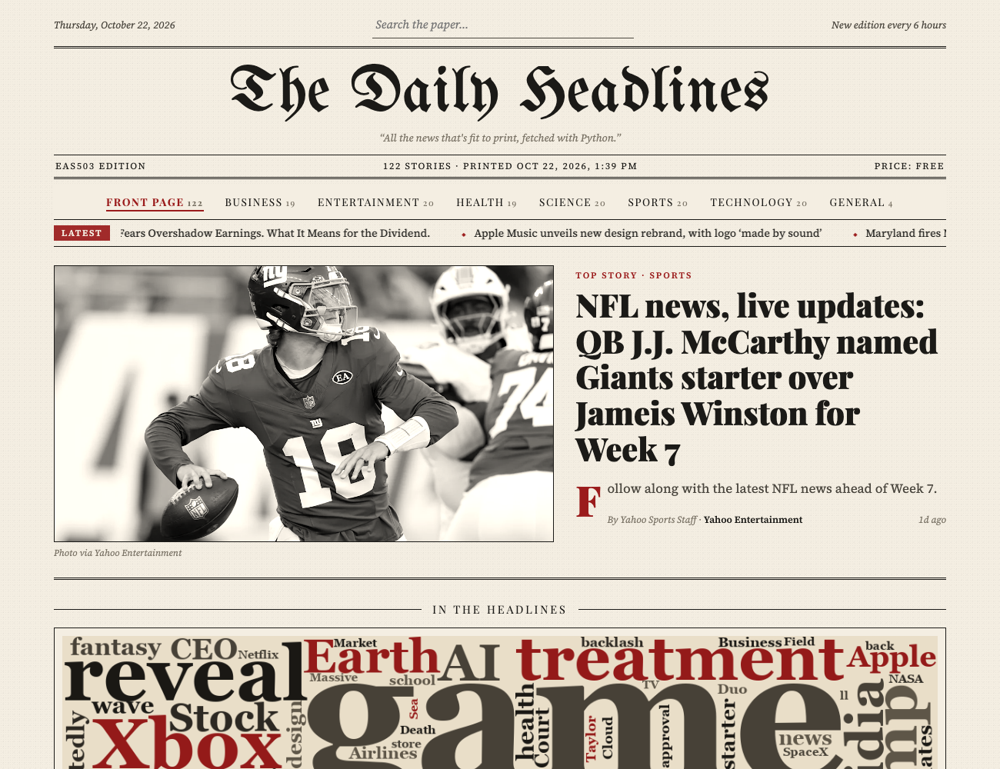

# The Daily Headlines

A newspaper-style front page of today's top US headlines, built with **Dash** and the [NewsAPI](https://newsapi.org).

**Live site:** https://adityapathak2004.github.io/daily-headlines/



## Features

- Front page with a lead story, section tabs (Business, Health, Sports, ...) and search
- Scrolling "Latest" ticker and a word cloud of trending words
- Black-and-white photos that turn to colour on hover, plus small fade-in animations
- Refreshes automatically every 6 hours on GitHub Pages

## Project structure

```
daily-headlines/
├── app.py                    # Dash app: fetches the news, builds the page, handles clicks/search
├── assets/
│   └── style.css             # Newspaper look: colours, fonts, animations (loaded by Dash automatically)
├── static_site/
│   ├── build.py              # Builds the static GitHub Pages version using app.py
│   └── index.html            # Static page template (same layout as the Dash app)
├── .github/workflows/
│   └── pages.yml             # Runs build.py every 6 hours and publishes to GitHub Pages
├── docs/
│   └── screenshot.png
└── requirements.txt
```

## Run locally

```bash
pip install -r requirements.txt
echo "NEWSAPI_KEY=your_key_here" > .env
python app.py
```

Then open http://127.0.0.1:8050

## How the live site works

GitHub Pages can't run Python, so a GitHub Action runs `static_site/build.py` every 6 hours.
It fetches the news with the same code as `app.py` and publishes a static copy of the page.
The API key is stored as the repository secret `NEWSAPI_KEY`.

---

Built for EAS503 by Aditya Pathak.
